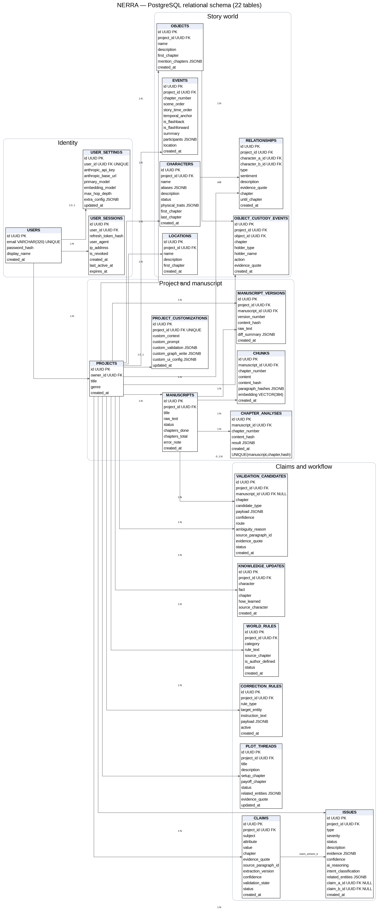

# NERRA — DBMS Checkpoint Deliverables

**Team**: T0123  
**Project**: NERRA (Intelligent Story Operating System for Novelists & Narrative Designers)  
**Lead**: Kushal Rathore  
**Members**: Adarsh Chauhan, Lakshya, Oojass Kwatra  
**Course Tracker**: [DBMS Project Tracker (T0123)](https://edusatyaki.github.io/dbms-project-tracker/)

---

## Repository Structure

```
.
└── dbms/
    ├── 01_normalization.md       # CP1: Complete 1NF, 2NF, 3NF, and BCNF normalization
    ├── 02_er_diagram.png         # CP2: Full entity-relationship diagram with keys & cardinalities
    ├── 03_schema.sql             # CP2: Production-ready PostgreSQL DDL schema with indexes
    ├── 04_queries.sql            # CP3: 20 application SQL queries marked -- READ / -- WRITE
    ├── 05_query_timings.md       # CP4: Query execution benchmarks (3 runs each, average in ms)
    └── plans/
        └── q12_claim_contradictions.txt # CP4: EXPLAIN (ANALYZE, BUFFERS) execution plan
```

---

## Checkpoint Overview

- **CP1 (Due Mon 16 Nov)**: `dbms/01_normalization.md` — Relational decomposition from unnormalized form (UNF) through First, Second, Third, and Boyce-Codd Normal Form (BCNF).
- **CP2 (Due Tue 17 Nov)**: `dbms/02_er_diagram.png` & `dbms/03_schema.sql` — ER diagram and PostgreSQL DDL schema.
- **CP3 (Due Thu 19 Nov)**: `dbms/04_queries.sql` — Application SQL queries with relational joins and read/write annotations.
- **CP4 (Due Mon 23 Nov)**: `dbms/05_query_timings.md` & `dbms/plans/` — 3-run timing benchmark and execution plan verification.

---

## ER Diagram Preview


